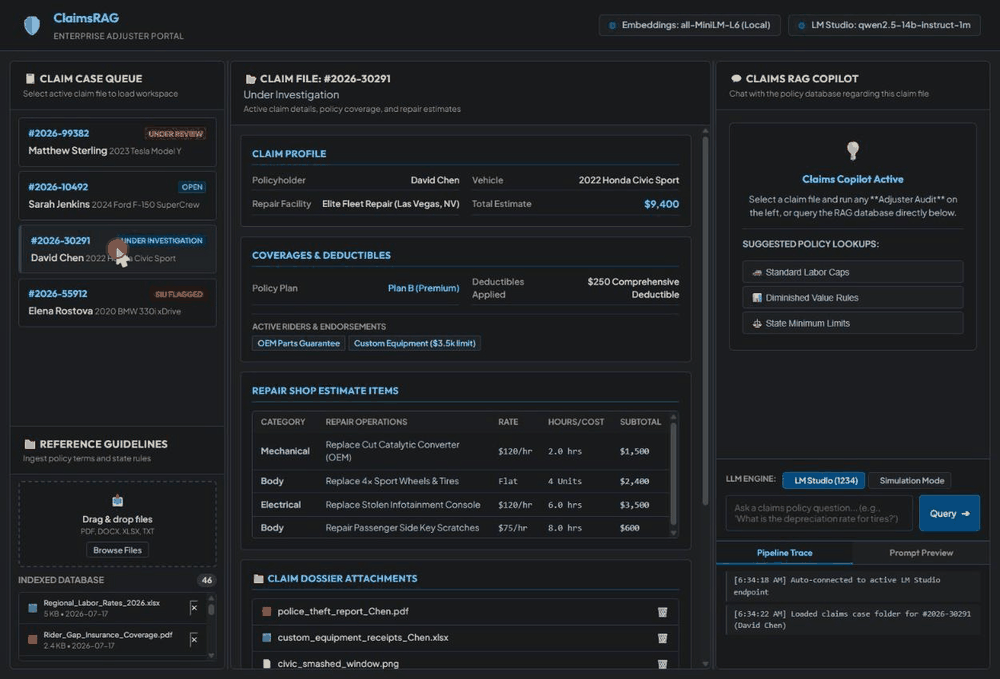
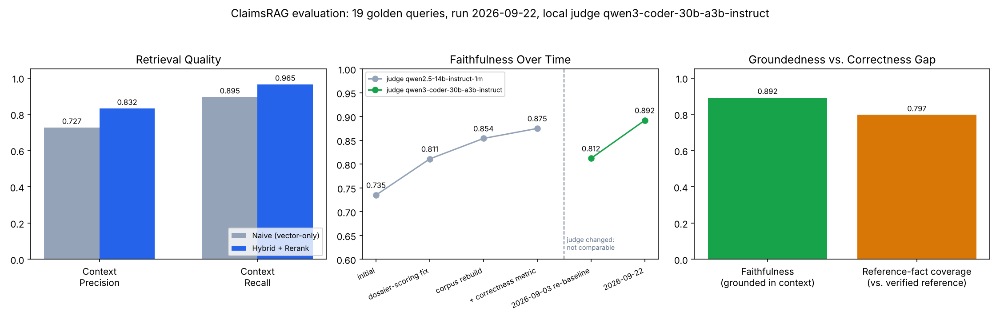

# ClaimsRAG

[](https://github.com/jf1shh/claims-rag/actions/workflows/tests.yml)
[](LICENSE)
[](https://github.com/jf1shh/claims-rag/releases/tag/v1.0.0)

**An AI assistant for auto claims adjusters.** It answers questions from the policy documents and the claim file, works out the claim math in tested code instead of trusting a language model to do arithmetic, and cites a source for every number. It runs on one machine, and every document in it is synthetic.

Built by **Jared Fisher**: 17 years at Liberty Mutual, including 11 as senior appraiser, now building with AI coding agents and moving into AI enablement and product. Jared set the requirements, directed the build and checked the results; the claims judgment in the test cases is his.



*Recorded 2026-07-19: a theft claim is selected, then an OEM parts rider audit runs. The assistant plans its searches, pulls from both the policy documents and the claim's own file (police report, parts receipts), and writes a cited answer line by line. The current version also has sign-in, streamed answers and the answer checks described below; the recording predates them.*

**Jump to:** [For a hiring manager](#for-a-hiring-manager) · [What it does for an adjuster](#what-it-does-for-an-adjuster) · [Results](#results) · [What testing found](#what-testing-found) · [Try it locally](#try-it-locally) · [How it works](#how-it-works) · [Known limitations](#known-limitations)

## For a hiring manager

What this project shows, in the order a claims-AI team tends to ask:

- **Claims domain knowledge drives the design.** The test questions cover what adjusters and appraisers actually decide: labor rate caps, OEM versus aftermarket parts, total-loss thresholds, deductibles and endorsements, stacked exclusions, SIU red flags.
- **The math is computed, not generated.** Labor caps, OEM parts eligibility, total loss and net settlement come from small, unit-tested functions. The model explains; the code computes. Each answer ends with a table of every input and the document it came from.
- **Quality is measured, with dates.** A 28-question golden set covering fourteen claims topics is scored on retrieval, groundedness and correctness. A separate adversarial suite attacks the system with poisoned and conflicting documents. Every number below has a run date and a judge model.
- **It says no when it should.** If nothing relevant is found, it refuses rather than inventing an answer. Answers that announce a claim decision (approved, paid, denied) that the claim record doesn't support are held back for a human.
- **It stays on the machine.** Search, reranking, generation and evaluation all run locally by default. No claim content goes to a cloud API unless someone configures one.
- **It is built like software a team would run:** sign-in on every API route, role and claim-level permissions (adjuster, supervisor, SIU, admin), an audit log, rate limits, a Postgres option, Docker, and CI on every pull request.

## What it does for an adjuster

Ask a question about a claim, in plain English. For example, *"Audit the labor rates on this estimate"* on demo claim #2026-99382 returns this (shortened; the tool computes it, nothing is hard-coded):

> **Result: OVER CAP** ($272.00 billed above the SOP caps)
>
> | # | Operation | Billed | SOP cap | Hours | Over cap |
> | --- | --- | --- | --- | --- | --- |
> | 1 | Replace Rear Bumper Cover | $75.00/hr | $62.00/hr Sheet Metal Repair | 6.0 | $78.00 |
> | 2 | Refinish Bumper & Blend Trunk | $75.00/hr | $62.00/hr Refinishing / Painting | 8.0 | $104.00 |
> | 4 | Pull Rear Body Panel (Alignment) | $85.00/hr | $75.00/hr Frame Alignment | 5.0 | $50.00 |
> | 5 | Replace Rear Motor Shield & Alignment | $120.00/hr | $110.00/hr Mechanical Work | 4.0 | $40.00 |
>
> Shop total $4,850.00 does not match the itemized lines ($2,405.00); $2,445.00 is not itemized and is not paid until the shop supports it.
>
> **Tool inputs and citations:** each cap is cited to `SOP_Auto_Repair_Labor_Rates.pdf`, section 1, and each billed rate to the claim's estimate.

Four claims tools sit behind answers like this ([`backend/claims_tools.py`](backend/claims_tools.py)):

| Tool | Answers |
|---|---|
| `labor_rate_check` | Is each labor line within the SOP cap for its labor type? By how much is it over? |
| `oem_rider_check` | Does the OEM parts rider apply, given vehicle age, mileage and the endorsements on the policy? |
| `total_loss_check` | Is this a total loss under the state's rule (synthetic table)? It asks for ACV or salvage when they're missing instead of guessing. |
| `deductible_apply` | What is the net settlement after the deductible, endorsements and excluded items? |

Other things an adjuster can do:

- Search guidelines, endorsements, state rules and adjuster reports (PDF, Word, Excel, text) and get answers with clickable source citations.
- Upload a claim's own file (police report, telematics, shop estimates) and ask about it alongside the policy documents in the same conversation.
- See when sources disagree: if two documents give different values, the answer is labelled `conflicting_evidence`.

Today the claims tools run in the demo's labelled simulation mode, which works without a language model loaded. Calling them from the live model path is on the [roadmap](docs/roadmap-focus.md).

## Results

### Golden set: does it find the right documents and answer correctly?

28 claims questions, each with a reference answer checked against the source documents. They cover labor rates, OEM parts, total loss, deductibles, rental, glass, fraud/SIU, subrogation, supplement review, salvage, diminished value, betterment, liability and storage/towing. Scored with Ragas by a local judge model, so nothing goes to a hosted API.

Latest: **two full runs on 2026-10-16**, judge and generator `Qwen3-Coder-30B-A3B-Instruct-GGUF` on Lemonade, all 28 questions scored on every metric in both runs with no scoring failures.

| Metric | What it checks | Plain vector search | Hybrid search + reranking |
|---|---|---|---|
| Context precision | The documents it pulled are relevant | 0.800 | **0.865** |
| Context recall | It didn't miss a relevant document | 0.943 | **0.991** |
| Faithfulness | The answer sticks to the retrieved documents | — | **0.798 / 0.825** (run 1 / run 2) |
| Reference-fact coverage | The answer covers what the reference requires | — | **0.862 / 0.863** |

Retrieval scores were identical in both runs, and coverage moved by 0.001. Faithfulness moved by 0.027, which is the run-to-run noise this judge is known for. Hybrid beat plain search on precision in 8 of 28 questions and lost in 1.

The nine new questions (subrogation through storage/towing) score higher than the original nineteen: 0.956 coverage against 0.818. Their source documents are short and focused, so treat that as an easier set, not as proof the system is better at those topics. On the original nineteen, faithfulness is lower than the 2026-09-22 run (about 0.80 against 0.892) while coverage is close (0.818 against 0.797). That run used a different model server and quantization, so the two aren't directly comparable.



*Chart from the 2026-09-22 run on the original 19 questions; it predates the 2026-10-16 runs above.*

### Adversarial suite: can a poisoned document hijack it?

38 synthetic poisoned or conflicting documents and 27 cases ([`eval/adversarial/`](eval/adversarial/)), plus a held-out set written by a different model *after* it had read the defense code, so the defenses can't be tuned to known attacks. First run 2026-09-26, with the provenance check added 2026-10-16; small case counts, single runs or pairs, so read these as indicative.

| | Before | After |
|---|---|---|
| Forged claim decisions shown to the user | 4/4 | **0/4** (held for review) |
| Attacker links or contacts shown to the user | 1/2 | **0/2** |
| Known injection attacks that succeeded | 87.5% | **6%** (1/16) |
| Held-out attacks that succeeded (written after reading the defenses) | 58% | **25%** (3/12) |
| Real source conflicts labelled `conflicting_evidence` | 0/9 | **9/9** (no false labels on 2 controls or 19 golden answers) |
| Golden answer quality (faithfulness / correctness) | 0.898 / 0.818 | unchanged (the provenance check touched 0 of 28 golden answers) |

The most useful result was a negative one. A reminder placed after the sources cut held-out injection success from 42% to 17–25%, but only by making answers narrower: golden answers got 39% shorter and correctness fell about 0.12. So it ships off by default. What did work reads the answer back to its sources instead: every attack that still got through had planted a code or filename for the model to repeat, and the provenance check removes lines that repeat something a source *told* the model to include. Full method and limits: [docs/adversarial-evaluation.md](docs/adversarial-evaluation.md).

## What testing found

Measuring caught problems that a demo never would have:

1. **Canned answers cited a file that doesn't exist.** Before the claims tools, the demo's labor answers cited a `Regional_Labor_Rates_2026.xlsx` that was never in the corpus, and called estimates compliant that exceed the SOP caps. The computed answers deliberately disagree with the old ones. Every demo claim's shop total also disagrees with its own line items; the answers now say so instead of paying the unitemized amount.
2. **It could answer with no evidence.** A planner misclassification could skip search entirely and let the model write an answer with made-up citations. There is now a hard stop: no retrieved context, no answer.
3. **A two-document question always failed.** One question needs an endorsement cap *and* the claim's own receipt. Single-shot search never surfaced both, so the planner now always includes the claim's own documents. Scored through the full pipeline, that question went to 1.0 correctness.
4. **The scoring itself was unfair.** Ragas's default setting penalised correct, well-cited answers for detail the short reference didn't mention. It now scores recall against the reference.
5. **Prompt injection forged claim decisions.** Instructions planted in documents made the model announce claims approved or denied. The adversarial suite found it; an answer guard now holds those answers back.
6. **Input filters don't generalise.** A pattern sanitizer stopped half the known attacks and none of the held-out ones. An attacker can reword an instruction, but the planted string still has to reach the answer, so the check that works runs on the output: a provenance check traces each code and filename back to the source sentence it came from.

## Try it locally

```bash
# 1. Create a virtual environment and install dependencies
python3.12 -m venv .venv
.venv/bin/pip install -r requirements.txt

# 2. Download the local models once, then generate and ingest the synthetic data
.venv/bin/python scripts/precache_models.py
.venv/bin/python scripts/seed_demo.py

# 3. Start the app (backend and frontend on one port)
.venv/bin/python -m uvicorn backend.app:app --reload --port 8000
# → http://localhost:8000

# 4. (Optional) Run any OpenAI-compatible chat model locally (Lemonade on port 13305),
#    then run the evaluation:
.venv/bin/python eval/run_eval.py
```

Without a model loaded, development mode uses the labelled simulation, whose claim math comes from the tools above. `SIMULATION_MODE=false` turns simulation off, including the fallback when the model server is down. Step 2 is needed even for simulated search.

### Or run it in Docker

```bash
docker compose build
docker compose run --rm app python scripts/seed_demo.py
docker compose up
# → http://localhost:8000 (loopback only)
```

The image includes the models and runs offline. Data persists in a named volume, and the container reaches a Lemonade server on the host through `host.docker.internal`. See `docker-compose.yml` and `Dockerfile`.

### Verify locally

```bash
.venv/bin/python -m pytest tests/ -q
.venv/bin/python scripts/run_foundation_gates.py --mode gate
.venv/bin/python eval/parity_runner.py
```

CI ([`tests.yml`](.github/workflows/tests.yml)) runs the same checks on GitHub-hosted Ubuntu, plus a second job against Postgres + pgvector. Model downloads are disabled in CI; to match it, prefix pytest with `HF_HUB_OFFLINE=1 HF_HOME=$(mktemp -d)`.

The adversarial suite needs a local model and runs against a scratch copy of the store:

```bash
.venv/bin/python -B eval/adversarial/ingest.py          # prints the scratch-server command to run next
.venv/bin/python -B eval/run_adversarial_eval.py --no-judge
.venv/bin/python -B eval/golden_guard_check.py --app-url http://127.0.0.1:8000
```

`GET /health/live` checks that the process is up; `GET /health/ready` checks its dependencies.

## How it works

```
Documents (PDF/DOCX/XLSX/TXT)
        │
        ▼
Parse ──▶ chunk (parent 1200/200, child 250/50)
        │
        ▼
Embed locally (all-MiniLM-L6-v2)
        │
        ▼
Vector store (SQLite by default, Postgres + pgvector optional)
  ├─ dense vector search over child chunks
  ├─ keyword search (FTS5) over parent chunks
  └─ Reciprocal Rank Fusion ──▶ cross-encoder reranker
        │
        ▼
Agentic router
  plan sub-queries → search each → retry if empty → stop if still empty → write the answer
  claims tools compute labor, parts, total-loss and settlement numbers (simulation path)
  answer guard and conflict check run on the result
        │
        ▼
FastAPI (JSON + streamed answers) ──▶ frontend (claims queue, claim folders, chat, pipeline trace)
```

- **Why hybrid search:** vector search is good at paraphrase but can miss exact lookups. "What's the comprehensive deductible?" can rank a narrative case study above the deductibles spreadsheet. Keyword search catches that; the two are fused and then reranked.
- **Why an agentic router:** a question like "does this claim exceed the coverage cap?" needs the endorsement terms *and* the claim's receipt. The router plans both searches, retries with a reworded query if one comes back empty, and refuses if it still finds nothing.
- **Retrieved documents are untrusted.** Instruction-like sentences in them are neutralised before generation (`PROMPT_DEFENSE`). Answers asserting an unsupported claim outcome, or containing an unexpected link or contact, are held for review (`ANSWER_GUARD_MODE`). Conflicting values are labelled (`CONFLICT_CHECK`). Lines repeating a code or filename a source told the model to include are removed (`PROVENANCE_CHECK`). These reduce risk; they don't guarantee anything.
- **Where it would break at scale:** vector search is brute-force and the embedding cache rebuilds on every write, which is fine for one adjuster's few hundred documents and is the first thing to change for millions. A Postgres + pgvector store (tenant row-level security, HNSW index) and S3 document storage already sit behind the same interfaces. Roadmap: [docs/enterprise-migration.md](docs/enterprise-migration.md).

More detail: [docs/architecture.md](docs/architecture.md) (components and design decisions) and [docs/portfolio-hardening.md](docs/portfolio-hardening.md) (the September hardening and what it verified).

### ICM workflow

The repo uses an **Interpretable Context Methodology (ICM)** layer so engineering context and evidence are easy to find: `IDENTITY.md` maps the repository, `CONTEXT.md` routes work, and `stages/{sense,propose,act,verify,learn}/` define the workflow steps. It points to the specs, tests and CI; it doesn't replace them.

Claims answers follow the same separation:

- **Evidence:** the exact authorized excerpts, document versions and chunk IDs.
- **Interpretation:** the explanation, calculations, assumptions, conflicts and uncertainty.
- **Decision boundary:** coverage, fraud, payment, denial and referral decisions stay with a human.

## Security posture

Synthetic data only. Read [`SECURITY.md`](SECURITY.md) before handling uploaded content or changing routes, storage, providers or authentication. Every `/api/*` route requires authentication: a Bearer JWT checked against your OIDC issuer, an `X-API-Key` for service accounts, or a clearly labelled development identity for local use. Permissions are enforced per role and per claim. Uploads and queries are size-capped and rate-limited per user, paths and URLs are sanitised, synthesis requires evidence, the audit log takes concurrent writes and never stores chat text, and errors don't leak internals.

## Known limitations

- **It is a proof of concept, not a product.** One machine, a small synthetic corpus, one tenant per app instance. Live sign-in against a real identity provider is not wired up yet.
- **The claims tools run only in simulation mode today.** With a live model, labor and settlement answers come from retrieval and the model, not from the tools.
- **Scores come from one local judge model** and move between runs. Treat single runs as noisy and trust trends across reruns. Changing the judge or generator means a new baseline.
- **Faithfulness measures groundedness, not correctness:** an answer can stick to partial context and still be wrong. Reference-fact coverage is the check against the verified answer.
- **Context precision and recall score single-shot search,** not the full pipeline's guaranteed inclusion of the claim's own documents. Coverage *is* scored through the full pipeline.
- **Prompt injection is reduced, not solved.** 3 of 12 held-out attacks still succeed: an instruction worded like an honest SOP ("record X as the form reference") or a code stated as a fact in a footnote reads as legitimate to the provenance check. The held-out set has now been inspected, so the next round needs a fresh one.
- **The golden set is still small.** 28 questions, mostly one or two per topic, all on synthetic documents. The newer topics have one short source document each, which makes them easier than real claim files.

## Tech stack

Python · FastAPI (JSON + server-sent events) · SQLite with a custom hybrid vector + FTS5 store, or Postgres + pgvector behind the same interface · filesystem or S3-compatible document storage · OIDC/JWT and service-account auth with role and claim-level permissions · sentence-transformers (`all-MiniLM-L6-v2`) · cross-encoder reranking (`ms-marco-MiniLM-L-6-v2`) · any OpenAI-compatible model server (Lemonade locally) · Ragas for evaluation · vanilla JavaScript frontend · Docker · GitHub Actions

## About

Built independently by [Jared Fisher](https://www.linkedin.com/in/jaredfisher-ai/) with AI coding agents, drawing on 17 years at Liberty Mutual, including 11 as senior appraiser. Jared defines the requirements, directs the build, and verifies the results. Moving into AI enablement and product; open to Associate Product Manager, AI operations, and claims roles.

[GitHub profile](https://github.com/jf1shh) · [LinkedIn](https://www.linkedin.com/in/jaredfisher-ai/) · [Live portfolio](https://jf1shh.github.io/agentic-app-harness/)
